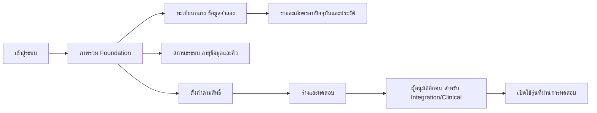

# Foundation flow and wireframes

Prepared before foundation UI implementation. Formal ANC/Lab representative review, approved visual baseline and manual ACR acceptance remain open; this document does not fabricate UQ-1/UQ-11 acceptance.

Desktop: fixed-width navigation beside a flexible workspace; page title and synthetic scope banner, then task content. Registry rows show LN, origin, current round and derived status with one details link. Mobile: navigation wraps above a single-column workspace; registry becomes readable rows with no hidden data or horizontal scrolling. Details never repeats intake fields. Setting category selector reveals one category at a time; draft validation and approval remain on the same page.

Login: labelled username/password, show-password control, password-manager compatible autocomplete, one submit action, specific recoverable failure text. Skeleton reserves content height; empty/error/success states use the same geometry. No modal is necessary in P1; UQ-7 modal-specific checks are not applicable. Unsaved setting drafts warn on leaving.

Tokens: Noto Sans Thai bundled locally, body 16px, 4/8px spacing scale, semantic colors, visible focus, minimum 44px touch controls. Reduced motion and print styles included. Accessibility automation covers all axe A/AA tags and all severity levels; automated evidence is separate from manual screen-reader/WCAG acceptance.
